<div align="center">

# Kage VPN

**A clean, native-feeling VPN manager for macOS, powered by [sing-box](https://sing-box.sagernet.org).**

Import your VLESS, VMess, Trojan, Shadowsocks or Hysteria2 servers, connect with one click, and see exactly where your traffic goes.


[](https://github.com/Shashi-Madushan/KageVPN/releases/latest)
[](https://shashi-madushan.github.io/KageVPN/)

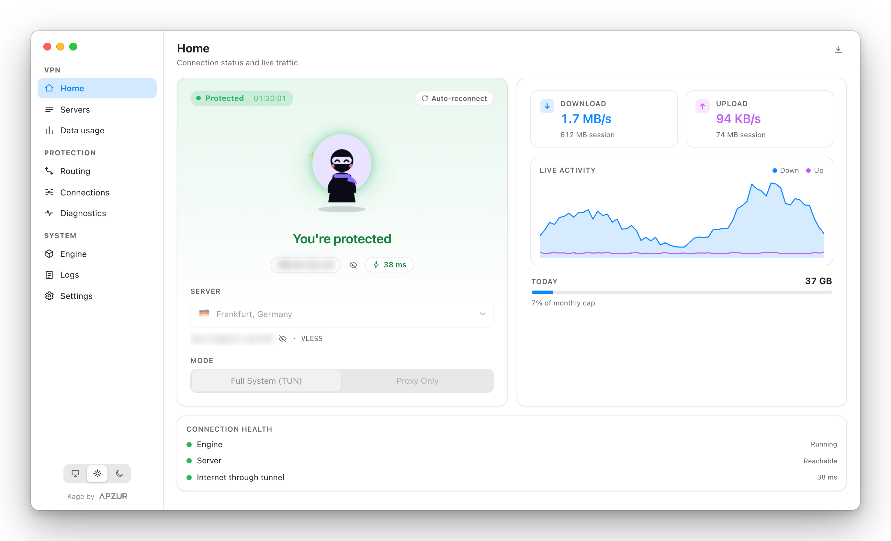

</div>

---

## What it is

Kage VPN is a desktop app that sits in your menu bar and manages a [sing-box](https://sing-box.sagernet.org) tunnel for you. You bring a server (a `vless://`, `vmess://`, `trojan://`, `ss://` or `hysteria2://` link, or a subscription URL from your provider); the app turns it into a working connection, keeps it healthy, and shows you what it is doing.

It is for people who already have a VLESS, VMess, Trojan, Shadowsocks or Hysteria2 server or provider and want a polished Mac app instead of hand-editing config files. It does not sell or provide VPN servers.

## Install

> **Requirements:** a Mac (Apple Silicon or Intel) and a server link or subscription. The app downloads the sing-box engine for you on first run.

1. **Download** the latest `.dmg` from the [Releases page](https://github.com/Shashi-Madushan/KageVPN/releases).
2. **Open** the disk image and drag **Kage VPN** into your **Applications** folder.
3. **Open the app.** The first time, macOS will probably stop it. That is expected, and the next section explains how to get past it.

### "Kage VPN cannot be opened" (unsigned app)

macOS Gatekeeper blocks apps that are not signed and notarized with a paid Apple Developer ID. Kage VPN is not notarized yet, so macOS shows a warning such as *"Apple could not verify Kage VPN is free of malware"* or *"Kage VPN is damaged and can't be opened"*. The file is not damaged: macOS adds a quarantine flag to everything downloaded from the internet, and that flag is what triggers the warning.

Only do this for a build you downloaded from this repository's Releases page.

**Option A: Open Anyway in System Settings** (works on every recent macOS, required on macOS 15 Sequoia and later)

1. Open the app once and click **Done** (or **Cancel**) on the warning.
2. Open **System Settings → Privacy & Security**.
3. Scroll to **Security**. You will see *"Kage VPN was blocked to protect your Mac."*
4. Click **Open Anyway**, enter your password, then click **Open**.

**Option B: Right-click → Open** (macOS 14 and earlier)

1. In **Applications**, hold **Control** and click **Kage VPN** (or right-click it).
2. Choose **Open**, then click **Open** again in the dialog.

**Option C: Remove the quarantine flag in Terminal**

This is the fix for the "is damaged and can't be opened" message.

```bash
xattr -dr com.apple.quarantine "/Applications/Kage VPN.app"
```

Then open the app normally. You only need to do this once per downloaded version. Updates that the app downloads and installs itself are checked against its own signing key and normally do not show the warning again.

### First run

1. A short **welcome tour** explains the basics. You can replay it from **Settings → Help**.
2. **Download the engine.** If sing-box is not installed, the app offers to download the official release, checks its published checksum, and keeps it in its own folder. If you already installed sing-box with Homebrew, the app uses that and skips the prompt.
3. **Add a server.** Paste a server link (or several, mixed protocols are fine), drop a text file, or add a subscription URL.
4. **Connect.** Click the Kage mascot. In **Full System (TUN)** mode macOS asks for your administrator password once so the app can create the tunnel.

### Uninstall

1. Quit the app from its menu-bar icon or **Settings → Quit**.
2. Drag **Kage VPN** from Applications to the Trash.
3. Optional, remove saved data (servers, settings, usage history, downloaded engines):
   ```bash
   rm -rf "$HOME/Library/Application Support/com.apzur.kage"
   ```
4. If you had the kill switch on and your internet stays blocked after an unexpected quit, open the app and use **Settings → Restore internet access**, or run:
   ```bash
   sudo pfctl -a "com.apple/250.KageVPN" -F all
   ```

## Features

### Connect

- **One-click connection** with a clear status: protected, connecting or not protected, plus session time, exit IP and latency.
- **Two modes.** *Full System (TUN)* sends all of your Mac's traffic through the VPN. *Proxy Only* runs a local proxy on `127.0.0.1:2080` for just the apps you point at it.
- **Five protocols.** VLESS (TLS or Reality), VMess, Trojan, Shadowsocks (including the 2022 ciphers) and Hysteria2 (with Salamander obfuscation). VLESS, VMess and Trojan run over TCP, WebSocket, gRPC or HTTPUpgrade.
- **Menu-bar app** with live download and upload speed beside the icon, and a compact popover led by the Kage mascot, which is also the connect button and shows at a glance whether you are protected. The popover has a latency pill, server and timer, live traffic and a mode switch, and shows loading skeletons while data loads.
- **Hide addresses.** Server addresses and IP addresses are blurred until you click the eye icon (next to the IP address, in the app and in the menu-bar popover), so screen shares and screenshots do not give them away. The choice is remembered.
- **Optional global shortcut** (⌥⌘V, off by default) to connect or disconnect from anywhere.
- **Launch at login** and **connect on launch**.

### Servers

- **Import** from pasted links, text files or **subscription URLs**, with scheduled refresh and the data and expiry information your provider reports.
- **Search, group, favorite and sort** servers. Duplicates are detected and skipped.
- **Latency tests** for every server, with a small history graph for each.
- **Fastest server automatically**, with failover when one stops working.
- **Share** a server as a link or QR code, and edit every field by hand when you need to.

### Protection and reliability

- **Verified connections.** The app says "You're protected" only after a real request has gone through the tunnel, keeps checking in the background, and tells you why when traffic stops (server not answering, server rejected the connection, or no traffic). Failed connects explain what went wrong, with a fix button.
- **Auto-reconnect** when the tunnel drops, and an optional **restart a dead tunnel** setting.
- **Crash log.** If sing-box or the tunnel stops on its own you get a notification with the reason, and an entry in a crash log you can open inside the app.
- **Kill switch** (experimental, TUN mode) that blocks traffic if the tunnel stops unexpectedly.
- **Routing rules** with Global, Rules and Direct modes. Match by domain, domain suffix, keyword, IP range or app name, send traffic through the VPN, direct, or block it, add country lists, bypass your local network, and choose your DNS resolver. A built-in tester shows which rule a domain would hit.
- **Live connections** with an **Apps** view (which app is sending and receiving data right now, with live speeds) and a table of every open connection, its app, destination, route and traffic, with the option to close any of them.

### Insight

- **Diagnostics** with a leak check (tunnel IP, system route and DNS resolver side by side) and a live **speed test** gauge for ping, jitter, download and upload through the tunnel.
- **Data usage** that opens on this month in plain language, with a day-by-day chart and a "Where did it go?" list of apps, sites and servers. An optional monthly limit and the privacy options live in Settings. Export to CSV. Detailed app and site recording can be turned off.
- **Logs** with level filters, search and plain-language hints for common errors.

### Engine and updates

- **Engine manager.** Download, switch between and remove sing-box versions on the stable or pre-release channel. Downloads run in the background with progress, are checksum-verified, and never replace a working engine if they fail.
- **Update policy** for the engine and for the app: *Ask me*, *Install automatically* or *Do nothing*. Automatic installs never interrupt a live connection, and restarting is always your choice.
- **Download manager** in the title bar for progress, cancel and retry.

### Polish

- **Light, dark or system** theme, switchable from the sidebar.
- **Responsive layout** that collapses to an icon rail in narrow windows.
- **Feedback form** (when the build is configured with a feedback endpoint) that shows exactly what would be sent and redacts server addresses and keys before anything leaves your Mac.

### Privacy and safety

- **No telemetry and no analytics.** The app only talks to your servers, the sing-box release host, and the diagnostic services you trigger yourself (IP lookup and Cloudflare speed test).
- **Everything is stored locally**, in `~/Library/Application Support/com.apzur.kage`, with owner-only permissions and atomic writes. A damaged data file is set aside rather than overwritten.

## Screenshots

All screenshots use made-up demo data: example hosts and documentation-range IP addresses.

| | |
|---|---|
| 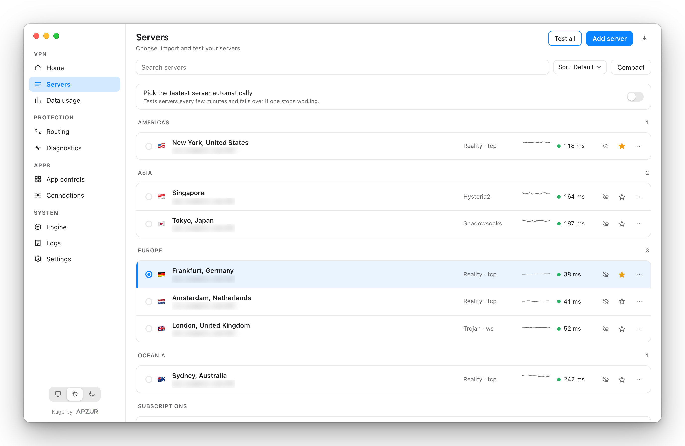<br>**Servers**: grouped, searchable, with live latency | 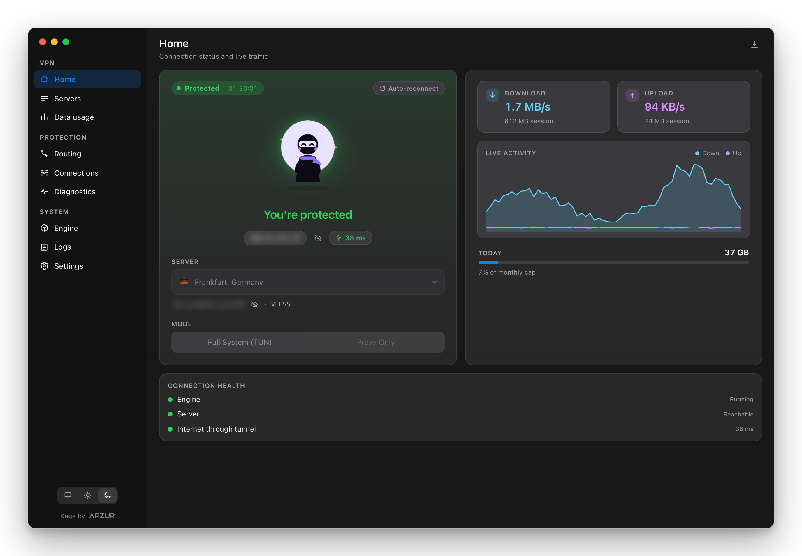<br>**Dark mode**: system, light or dark |
| 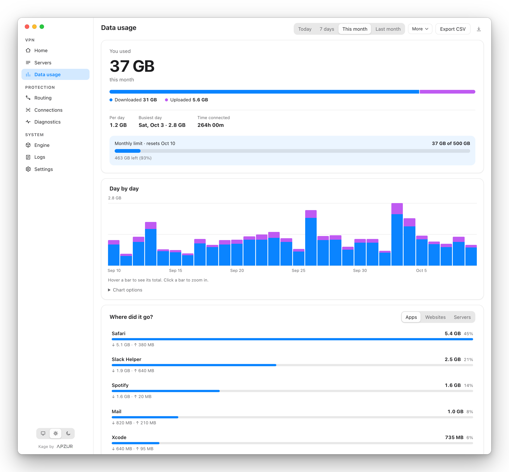<br>**Data usage**: totals, trend and per-app breakdown | 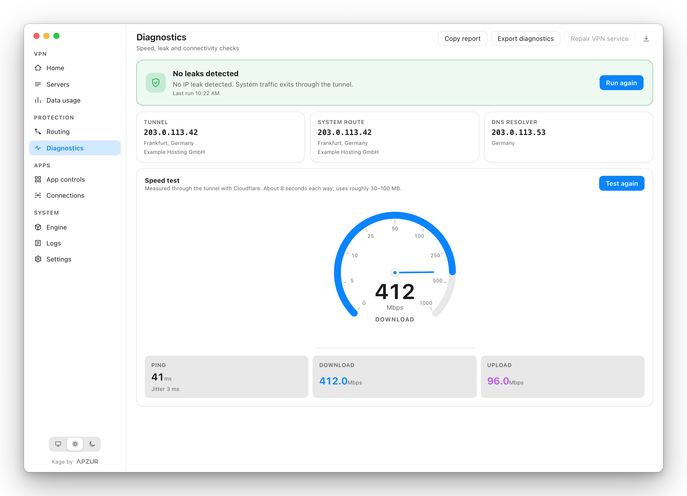<br>**Diagnostics**: leak check and speed test |
| 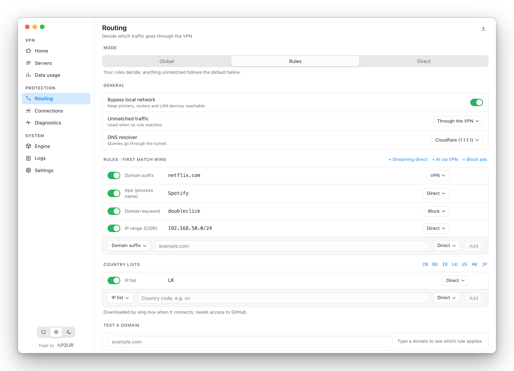<br>**Routing**: rules, country lists and DNS | 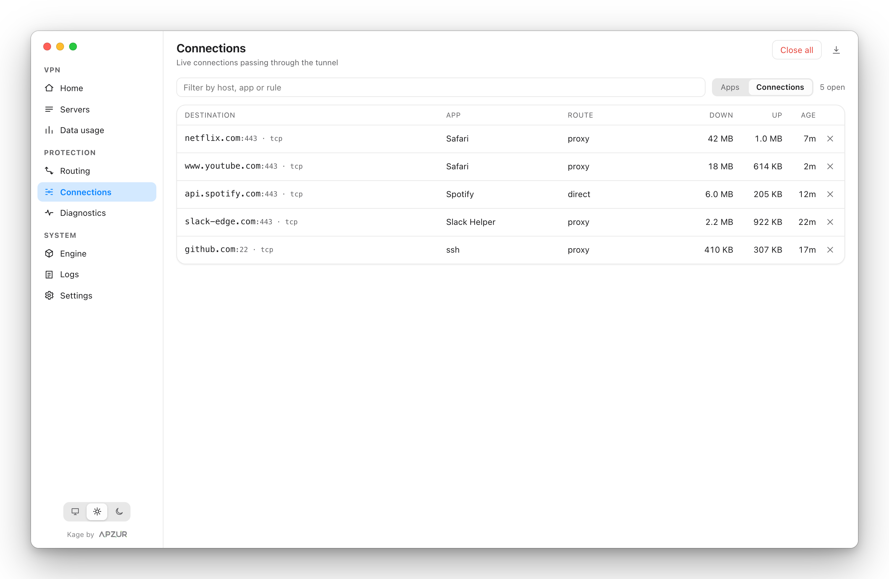<br>**Connections**: every open connection, live |
| 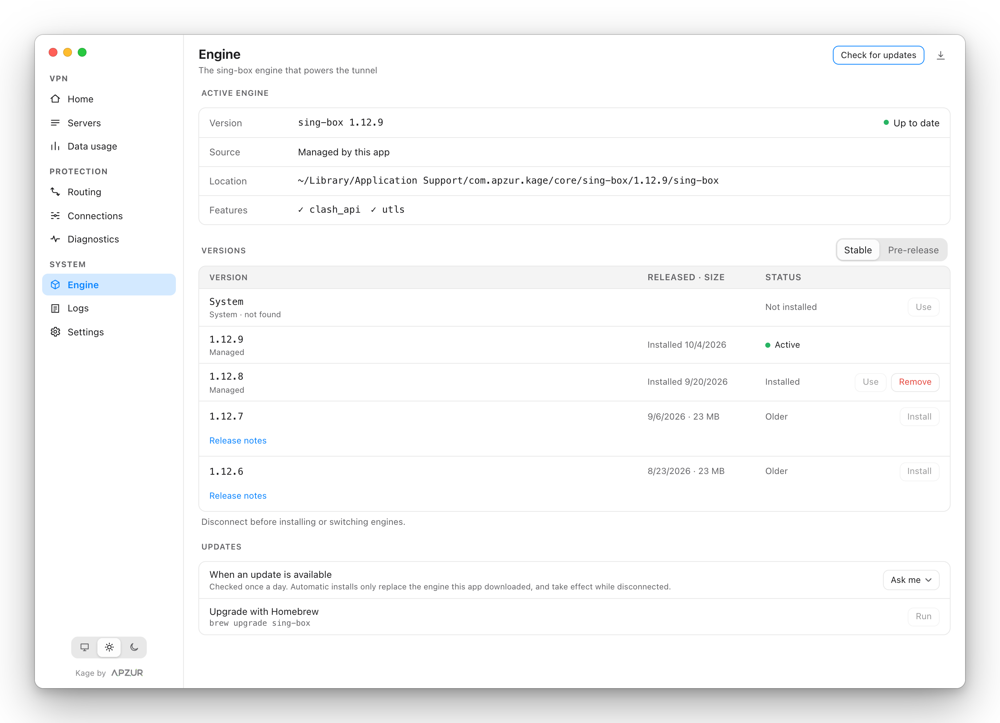<br>**Engine**: versions, channels and update policy | 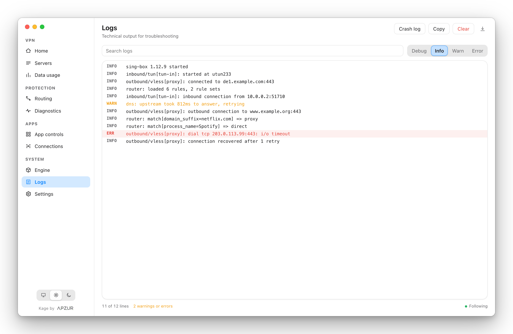<br>**Logs**: filters, search and error hints |
| 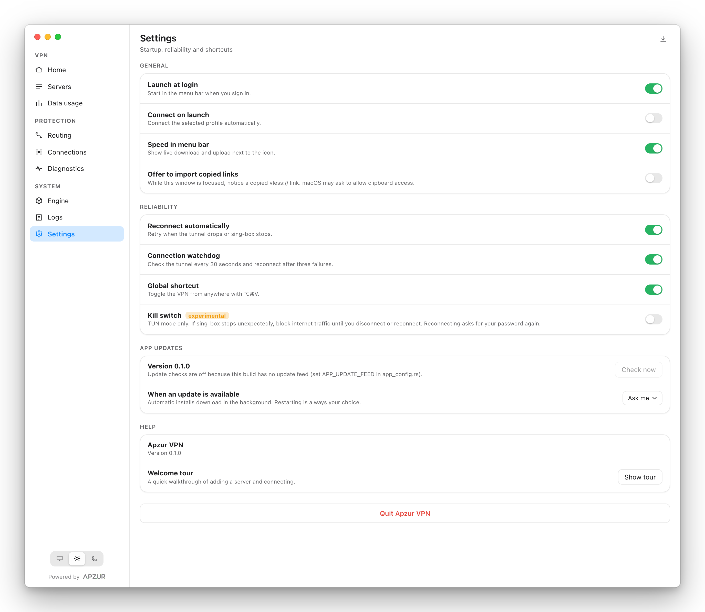<br>**Settings**: reliability, updates and shortcuts | 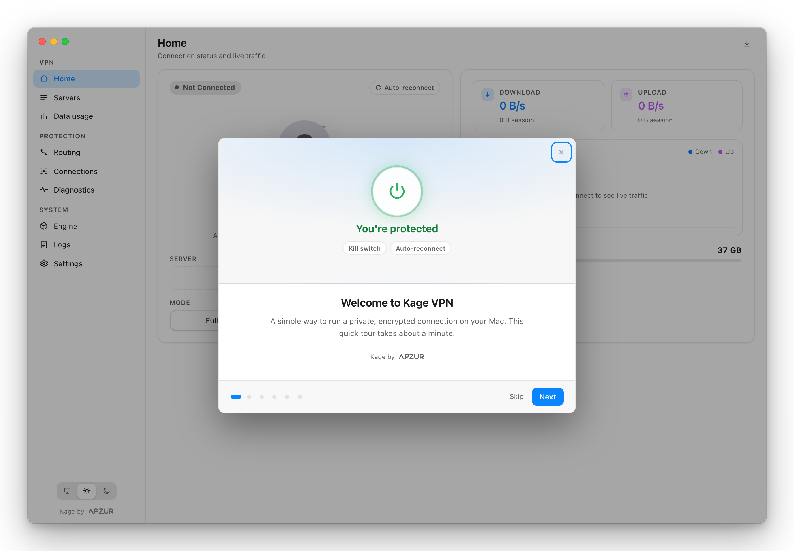<br>**Welcome tour**: first-run setup |

<div align="center">
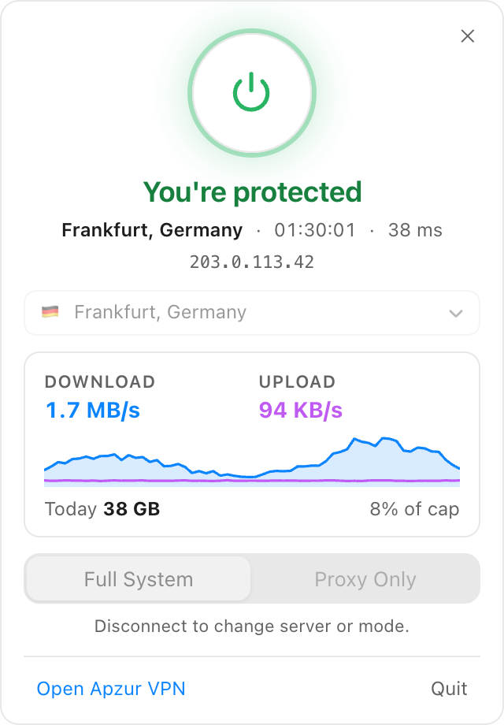<br>
<b>Menu-bar popover</b>
</div>

## Build from source

You need macOS, [Node.js](https://nodejs.org) 20 or newer, [Rust](https://rustup.rs) (stable) and the Xcode command line tools (`xcode-select --install`).

```bash
git clone https://github.com/Shashi-Madushan/KageVPN.git
cd KageVPN
npm install
npm run tauri dev          # run the app with hot reload
```

Build an app bundle:

```bash
npm run build:app
```

The result is in `src-tauri/target/release/bundle/macos/`. This is an unsigned local build. A plain `npm run tauri build` asks for the update signing key (`TAURI_SIGNING_PRIVATE_KEY`) because the project is set up to produce signed update archives; use `npm run release` for that (see [docs/RELEASING.md](docs/RELEASING.md)).

### Checks

```bash
npm run check              # Svelte and TypeScript
npm run test:scripts       # release script helpers
(cd src-tauri && cargo test)   # Rust unit tests
```

### Regenerate the screenshots

```bash
npm run screenshots        # needs Chrome, Brave or Edge; writes docs/images
```

### Project layout

| Path | What lives there |
|---|---|
| `src/` | Svelte 5 interface: pages, components and state |
| `src-tauri/src/app_config.rs` | The one place for names, cores, release and feedback endpoints, and outside services |
| `src-tauri/src/core/` | Engine download, verification and version management |
| `src-tauri/src/downloads.rs` | Shared download manager used by the engine and app updater |
| `src-tauri/src/app_update.rs` | Signed app updates |
| `src-tauri/src/feedback.rs` | Feedback reports and redaction |
| `src-tauri/src/profile/` | One module per protocol (link parsing, validation, sing-box outbound) behind a registry in `mod.rs` |
| `src-tauri/src/config.rs`, `session.rs`, `runner/` | sing-box config generation and process control |
| `src-tauri/src/tests/` | Rust unit tests |
| `scripts/` | Release and screenshot tooling |
| `docs/` | Design notes, the release guide and screenshots |

To rename the app or point it at your own release and feedback servers, edit `src-tauri/src/app_config.rs`. For shipping a new version, see [docs/RELEASING.md](docs/RELEASING.md).

## Roadmap

- Apple notarization, so first launch needs no extra steps.
- More engine types alongside sing-box. The download side is already built; each new engine needs a small adapter.
- A published release feed for automatic app updates.

## Contributing

Issues and pull requests are welcome. Please run the checks above before sending a change.

## Author and contact

**Shashi Madushan**, software developer and the maker of Kage VPN.

- GitHub: [@Shashi-Madushan](https://github.com/Shashi-Madushan)
- Email: [shashisulakshan@gmail.com](mailto:shashisulakshan@gmail.com)
<!-- LinkedIn: add your profile link here, for example: - LinkedIn: [Your Name](https://www.linkedin.com/in/your-handle) -->

## License

[MIT](LICENSE) © 2026 Shashi Madushan. sing-box is a separate project with its own license; Kage VPN downloads and runs it but does not modify it.

---

<div align="center">
<sub>Kage by <b>Apzur</b></sub>
</div>
