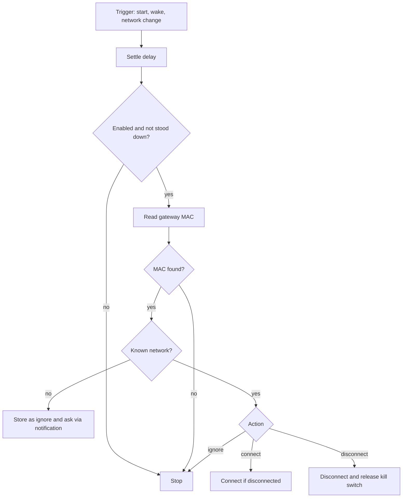

# Business logic model

Text alternative: after a trigger and a settle delay, if the feature is on and not stood down, read the gateway MAC; an unknown network is stored as ignore and the user is asked; a known one runs its action (connect, disconnect, ignore).

Pure core for tests: `decide(settings, current_id, state, manual_override) -> Decision { Nothing | AskAbout(id) | Connect | Disconnect }`. Gateway reading and notifications are thin wrappers around it.
