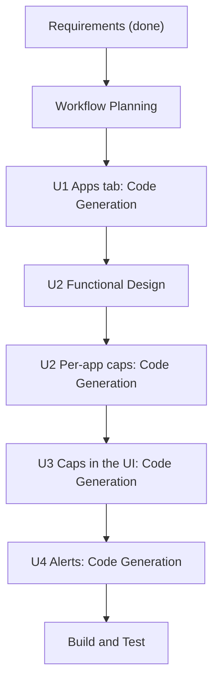

# Execution plan: per-app controls

## Analysis
- **Type:** enhancement, brownfield. **Risk:** Medium. **Impact:** Routing page (new Apps tab), usage module (per-app caps), session (rule apply and reconnect), settings, tray popover, Home banner, notifications.
- **Components touched:** `settings.rs` (`Rule` gains an origin, new per-app cap settings), `usage/` (per-app period totals and the cap check on the existing poll), `session.rs` and `config.rs` (rule apply, refuse a rule that blocks the VPN's own traffic), `apps.rs` (icons), `tray.rs` and `routes/tray`, `notify.rs`, `RoutingPage.svelte` (new Apps tab), `HomePage.svelte` (banner), `app.svelte.ts`, `api.ts`.
- **Risks found while reading the code:**
  1. Usage is recorded per **process name** per hour (`KIND_APP` in `usage/collector.rs`), not per app bundle. "Google Chrome Helper (Renderer)" must roll up to "Google Chrome" (the Connections page already does this with `appName`). A cap needs one mapping from process name to app, used by both counting and the Apps tab.
  2. Usage recording can be switched off (`recordApps`). Caps need it; the UI must say so and offer to turn it on.
  3. A routing change reconnects the VPN today. A cap block is therefore a user-confirmed action (as required), and the reconnect is a known interruption.
  4. A block rule for an app that is also the VPN's own client (for example the Kage app or sing-box) would cut the tunnel: refuse those.

## Stages
| Stage | Decision | Why |
|---|---|---|
| Workspace Detection, Reverse Engineering, Requirements | Done | |
| User Stories | SKIP | requirements already precise; one developer |
| Application Design | SKIP | no new component boundaries; features extend routing, usage and tray |
| Units Generation | SKIP (units below) | four small units, sequential |
| Functional Design | EXECUTE for U2 only | cap period maths, process-to-app mapping, rule origin and unblock logic have real decisions |
| NFR Requirements / NFR Design / Infrastructure Design | SKIP | extensions off; NFRs are in the requirements |
| Code Generation | EXECUTE per unit | |
| Build and Test | EXECUTE | |

## Units (sequential, each fully done before the next)
1. **U1 Apps tab** (FR1, FR3): searchable installed-apps list with icons, a VPN / Direct / Block switch per app, the two presets, process-name rows, one confirmation per batch of changes, refusal of rules that would block the VPN itself. Mostly front-end; reuses `routeApp` and the existing rule storage. Rule gains an `origin` field (manual or cap) so the UI can tell the two kinds of block apart.
2. **U2 Per-app caps, backend** (FR2.1 to FR2.7): per-app cap settings (bytes, period), period boundaries, per-app usage totals rolled up by app, cap check on the existing 2-second poll, 80 and 100 percent notifications once per period, **Block now** and **Unblock** commands, automatic unblock at reset. Functional design first.
3. **U3 Caps in the UI** (FR1.3, FR2.5, FR2.6): cap editor and usage bar on each Apps row, Home banner with Block now, "recording is off" prompt.
4. **U4 Low-data and expiry alerts** (FR4): 90 percent data and 7, 3 and 1 day expiry thresholds, popover text, notification once per threshold per plan period.

Text alternative: U1 code, then U2 functional design and code, then U3 code, then U4 code, then build and test.

## Success criteria
`cargo test`, `cargo clippy --all-targets -- -D warnings`, `svelte-check`, `vite build` green; docs-site guide and changelog updated; a new unit test for each pure rule (period bounds, cap decision, process-to-app rollup, refusal of a self-blocking rule); a manual checklist for the reconnect after Block now and for notification actions; PR from this branch to `dev`.

## Decisions to confirm
- Skip User Stories, Application Design and Units Generation as above.
- Run Functional Design for U2 only.
- Order: U1, U2, U3, U4. Each unit gets a code generation plan with checkboxes for your approval before code is written.
