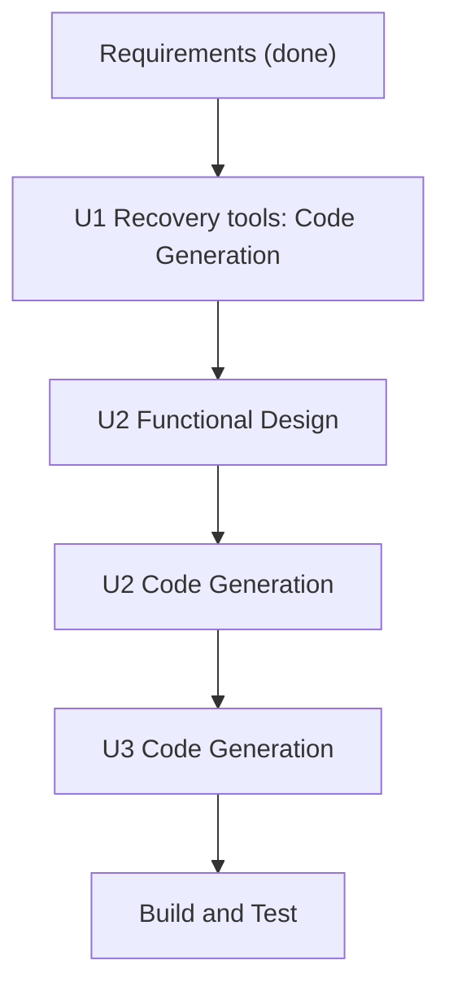

# Execution Plan

## Analysis
- Type: enhancement, brownfield. Risk: Low-Medium (root service reinstall and engine swap are the risky parts). Impact: Core page, Diagnostics, Settings, tray popover, network watcher.
- Components touched: `core/` (engine manager), `runner/` (service install), `network_watch.rs`, `session.rs`, `diagnostics.rs`/`feedback.rs` (redaction), `settings.rs`, `tray.rs` + `routes/tray`, Settings/Core/Diagnostics Svelte pages.

## Stages
| Stage | Decision | Why |
|---|---|---|
| Workspace Detection, Reverse Engineering, Requirements | Done | |
| User Stories | SKIP | small single-user features, requirements are precise |
| Application Design | SKIP | no new component boundaries; each feature extends an existing module |
| Units Generation | SKIP (units defined below) | three small units, one developer |
| Functional Design | EXECUTE for U2 only (network identity and action rules); skip U1, U3 | U2 has real decision logic |
| NFR Requirements / NFR Design / Infrastructure Design | SKIP | extensions off, no infra, covered by requirements NFRs |
| Code Generation | EXECUTE per unit | |
| Build and Test | EXECUTE | |

## Units (sequential, each fully done before the next)
1. **U1 Recovery tools**: diagnostics bundle (FR2), engine rollback + remove old versions (FR3), Repair VPN service (FR4).
2. **U2 Auto-connect by network** (FR1).
3. **U3 Popover switcher + App Nap** (FR6, FR5).

Text alternative: U1 code generation, then U2 functional design and code, then U3 code, then build and test.

## Success criteria
`cargo test`, `cargo clippy --all-targets -- -D warnings`, `svelte-check`, `vite build` green; docs + changelog updated; PR from a feature branch to `dev`. Manual-check list for root-service actions.
