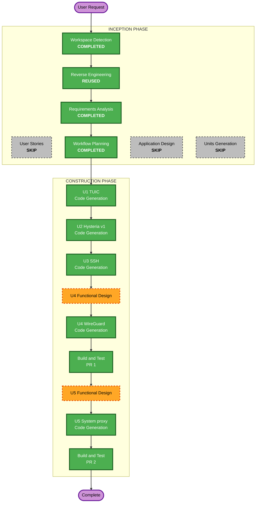

# Execution plan: more protocols and system-proxy mode

Round 4, branch `feature/protocols-and-system-proxy`. Requirements: `inception/requirements/protocols-and-system-proxy-requirements.md` (approved).

## Analysis
- **Type:** new features, brownfield. **Risk:** Medium. Protocols are low risk (one module each, covered by the conformance suite and the real `sing-box check`) except WireGuard, which touches the shared config builder. The system proxy is the riskier part: it changes macOS network settings outside the app, and a wrong restore breaks every app on the Mac.
- **Rollback:** easy for protocols (remove from `REGISTRY`, put the scheme back in `UNSUPPORTED`); moderate for the system proxy (the toggle is off by default, and the restore file and Repair action recover a Mac left with Kage's settings).

### Change impact
- **User-facing:** yes. Four protocols in the picker, editor and import; a Settings toggle and bypass list; a Home indicator and Repair action.
- **Structural:** yes, small. `ProtocolDef` gains a way to say a server is an endpoint (WireGuard); `config.rs` puts those servers in `endpoints`. One new backend module for the system proxy, called from the session and the supervisor.
- **Data model:** new protocol settings structs inside saved profiles (no change to how profiles are stored); new settings fields for the system proxy toggle and extra bypass entries; a restore file on disk.
- **API (Tauri commands):** settings save gains the new fields; a repair command for the system proxy. Protocol views are already read from the backend.
- **NFR:** live-machine safety while testing, privilege prompts, engine version check for WireGuard.

### Components touched
| Component | Change | Unit |
|---|---|---|
| `profile/tuic.rs`, `hysteria.rs`, `ssh.rs`, `wireguard.rs` (new) | protocol modules | U1 to U4 |
| `profile/mod.rs` | `REGISTRY`; endpoint kind on `ProtocolDef` and `Profile::outbound` | U1 to U4 |
| `profile/form.rs` | multi-line field kind for the SSH private key | U3 |
| `profile/links.rs` | remove schemes from `UNSUPPORTED`; import notes (Hysteria default speeds); `.conf` detection | U2, U4 |
| `profile/formats.rs` | sing-box JSON and Clash YAML entries for the four types | U1 to U4 |
| `config.rs` | `endpoints` array for WireGuard nodes | U4 |
| `core/version.rs` or session start | refuse WireGuard on engines older than 1.11 with a clear message | U4 |
| Server editor (Svelte) | render the multi-line field kind; show import notes | U2, U3 |
| `sysproxy.rs` (new), `session.rs`, `runner/supervisor.sh`, `settings.rs`, `lib.rs` (startup restore) | system proxy | U5 |
| Settings page, Home page (Svelte), `api.ts` | toggle, bypass list, indicator, Repair | U5 |
| Docs, changelog, screenshots fixture | | each unit and Build and Test |

### Risks found while reading the code
1. **One outbound call site.** `Profile::outbound` is only called from `config.rs:108`, so the endpoint split is contained. sing-box treats an endpoint tag as an outbound for selector, urltest, route rules and the Clash API delay test, so the rest of the app needs no change; this is checked with `sing-box check` and a real delay test.
2. **Import notes do not exist yet.** `parse` returns a profile or an error. "Imported with default speeds" needs a note channel from parse to the import result. Kept minimal and reusable.
3. **No multi-line field.** `form::Kind` has Text, Secret, Select, Segmented, Toggle, List. A private key needs a multi-line secret.
4. **The supervisor already exits with the app** (`supervisor.sh` watches the parent pid), so it is the natural place for the crash restore. It runs as the user; whether `networksetup` works without an administrator password decides if it can restore alone (open point from requirements, settled in U5 functional design by a read-only check on this Mac).
5. **Ports change.** The local port may not be 2080, so the system proxy must use the port of the current run, and a reconnect on a new port must update it.
6. **Live VPN on this Mac.** Your real Kage VPN uses 2080 and 19090. System-proxy runtime checks use a spare port and a test build, with every service's settings saved before and compared after.

## Stages
| Stage | Decision | Why |
|---|---|---|
| Workspace Detection, Reverse Engineering, Requirements | Done | |
| User Stories | SKIP | approved: requirements are specific, one developer |
| Application Design | SKIP | one new module (`sysproxy.rs`); its interface is designed in U5 Functional Design; the rest extends the protocol registry along its documented path |
| Units Generation | SKIP (units listed below) | five units, sequential, already clear |
| Functional Design | EXECUTE for U4 and U5 | U4: endpoint split, `.conf` parsing and rejection rules; U5: set and restore state, restore file format, who restores when, privilege check |
| NFR Requirements, NFR Design | SKIP | extensions are off; the NFRs are in the requirements |
| Infrastructure Design | SKIP | desktop app, no infrastructure |
| Code Generation | EXECUTE per unit | plan with checkboxes approved before code is written |
| Build and Test | EXECUTE | after each pull request's units |

## Units (sequential, each fully done before the next)
**Pull request 1: protocols**
1. **U1 TUIC** (FR1.1, FR1.5, FR1.6): module, links, sing-box JSON and Clash YAML entries, v4 rejection, tests, sample.
2. **U2 Hysteria v1** (FR1.2): module, the import note channel and its display, default speeds, port-hopping rejection, subscription entries, tests.
3. **U3 SSH** (FR1.4, FR1.8): module, multi-line secret field kind (backend and editor), missing host key warning in the editor and list, subscription entries, tests.
4. **U4 WireGuard** (FR1.3): Functional Design first. Endpoint kind on `ProtocolDef`, `endpoints` in `config.rs`, `wireguard://` and `wg://` links, wg-quick `.conf` import (paste and drop), multi-peer and AmneziaWG rejection, engine version check, subscription entries, tests.

Then **Build and Test** for pull request 1, docs (`ADDING-A-PROTOCOL.md` table, user guide, README, changelog), screenshot fixture, PR to `dev`.

**Pull request 2: system proxy**

5. **U5 System proxy** (FR2): Functional Design first. `sysproxy.rs` (read, save, set, restore for every enabled service; the restore file), session hooks (after verify, on disconnect, mode or toggle change, port change), supervisor restore on app or sing-box death, startup restore, Settings toggle and bypass list (unavailable while the proxy login is on), Home indicator and Repair, tests.

Then **Build and Test** for pull request 2 including the runtime check on a spare port, docs and changelog, PR to `dev`.

## Workflow visualization

Text alternative:
- INCEPTION: Workspace Detection (completed), Reverse Engineering (reused), Requirements Analysis (completed), User Stories (skip), Workflow Planning (completed), Application Design (skip), Units Generation (skip).
- CONSTRUCTION, pull request 1: U1 TUIC code, U2 Hysteria v1 code, U3 SSH code, U4 functional design then code, Build and Test.
- CONSTRUCTION, pull request 2: U5 functional design then code, Build and Test.
- OPERATIONS: placeholder.

## Success criteria
- `cargo test` (including the conformance suite and real `sing-box check` for every new protocol), `cargo clippy --all-targets -- -D warnings`, `svelte-check`, script tests and `vite build` green after each unit.
- Every rejection in the requirements has a test with its message.
- System proxy: unit tests for the pure set and restore decisions; a runtime check on a spare port where every service's proxy settings are identical before and after, including after killing the app mid-connection.
- Docs, changelog and screenshot fixture updated; two PRs to `dev`, in order.

## Decisions to confirm
- Skip User Stories, Application Design, Units Generation, NFR and Infrastructure stages.
- Functional Design for U4 and U5 only.
- Order U1, U2, U3, U4 (PR 1), then U5 (PR 2). Each unit gets a code generation plan with checkboxes for your approval before code is written.
