# Execution plan: universal macOS build, QR import, Windows support

Round 5. Requirements: `inception/requirements/universal-qr-windows-requirements.md` (approved).

## Analysis
- **Type:** release tooling, a new feature, and a new platform. Brownfield.
- **Risk:**
  - Part A is **Low**. The release script and one dialog change; there is no runtime change on the user's Mac.
  - Part B is **High**, for three reasons. It moves macOS platform code behind `cfg` modules, which could break macOS. It adds a privileged Windows service (phase 2) and firewall filters (phase 3). And none of it can run on this Mac.
- **Rollback:**
  - Part A is easy: revert the script, remove the import buttons.
  - Part B, phase 1 is easy: Windows is a new target and macOS code only moves.
  - Part B, phases 2 and 3 are moderate: the service can be removed from Settings and the installer uninstalls it.

### Change impact
- **User-facing:** QR import buttons and drop target on macOS. On Windows, the whole app.
- **Structural:**
  - Part A: none.
  - Part B: one platform layer with a macOS and a Windows implementation per area, a platform query for the front end, and a Windows service (phase 2).
- **Data model:** none. Settings stay the same; Windows-only fields are not needed in phase 1.
- **API (Tauri commands):**
  - `platform()` for the front end.
  - Window controls (minimize, maximize, close) for the custom title bar.
  - Service install, repair and remove in phase 2.
- **NFR:**
  - macOS must not regress.
  - No console windows on Windows.
  - Installer size.
  - The privileged service's attack surface (phase 2).
  - The live VPN on this Mac.

### Components touched
| Component | Change | Unit |
|---|---|---|
| `scripts/release.mjs`, `release-lib.mjs`, `scripts/tests` | universal target, artifact names, feed entries | A1 |
| `ImportDialog.svelte`, a QR decode helper, `package.json` | image file, drop, clipboard decode | A2 |
| `paths.rs`, `fsutil.rs` | Windows folders; Unix permission code behind `cfg(unix)` | W1 |
| `core/installer.rs`, `core/releases.rs`, `core/provider.rs` | zip extraction, `windows-*` asset names, `sing-box.exe` | W1 |
| `runner/` (`mod.rs`, `daemon.rs`, scripts) | split into `runner/macos/` and `runner/windows/`; Windows Proxy Only through a job object | W1, W2 |
| `sysproxy.rs` | split; Windows WinINet set and restore | W2 |
| `session.rs`, `lib.rs`, `reliability.rs` | call the platform layer instead of macOS calls; hide TUN and kill switch on Windows | W1, W2 |
| `tauri.conf.json` and a Windows override config | window decorations, Mica, NSIS bundle | W3, W5 |
| `tray.rs` | popover position above the taskbar | W3 |
| Svelte shell (`+layout`, `Sidebar`, a new `TitleBar`), `pages.ts`, `api.ts` | platform store, title bar with window buttons, `Ctrl` labels, macOS-only text | W3 |
| `apps.rs`, `network_watch.rs`, `networks.rs`, `sampler.rs`, `appnap.rs`, `notify.rs`, `deeplink.rs` | Windows implementations or `cfg` out | W4 |
| `Cargo.toml` | `windows-sys` (Windows only), `zip` crate, single-instance plugin | W1, W4 |
| New service binary or `--service` mode, named pipe, `%ProgramData%` engine copy | phase 2 | W6 |
| TUN mode UI, Diagnostics service status and repair | phase 2 | W7 |
| WFP filters in the service, kill-switch UI on Windows | phase 3 | W8 |
| Docs: README, user guide, changelog, `docs/WINDOWS.md` (build and test guide) | each part | all |

### Risks found while reading the code
1. **There are 18 `cfg` sites, and the macOS tools are called by name from many modules.** These include `osascript`, `networksetup`, `pfctl`, `scutil`, `route`, `ps` and `sips`. Splitting them must not change macOS behaviour. The macOS tests run after every unit, and `cargo check --target x86_64-pc-windows-msvc` proves the Windows side builds.
2. **`helper.sh` and `supervisor.sh` are shell scripts**, so Windows needs Rust code for them, not ports of the scripts. Phase 1 needs only the supervisor's job (stop sing-box when the app dies, restore the proxy). A Windows job object does the first part. The proxy restore runs at the next launch, plus a watcher.
3. **The window effects in `tauri.conf.json` are macOS names** (`sidebar`, `popover`, `titleBarStyle: Overlay`). Tauri merges a `tauri.windows.conf.json` on Windows, which keeps the macOS file unchanged.
4. **The `macos-private-api` feature** is ignored on other targets. This needs checking with the Windows `cargo check`.
5. **Cross-checking from this Mac.** Only `aarch64-apple-darwin` is installed. `rustup target add x86_64-pc-windows-msvc` is needed for `cargo check`. Linking is not possible here, so `cargo test` for Windows code runs only on your device.
6. **The branch base.** `feature/home-tray-redesign` (12 commits) is not merged into `dev` yet, and Part A and the Windows title bar build on its UI.

## Stages
| Stage | Decision | Why |
|---|---|---|
| Workspace Detection, Reverse Engineering, Requirements | Done | |
| User Stories | SKIP | one developer; requirements are specific |
| Application Design | **EXECUTE for Part B**, before W1 | it defines the platform layer: which areas, the interface per area, where macOS code moves, how the front end learns the platform, and the service boundary for phase 2 |
| Units Generation | SKIP (units listed below) | units are clear from the requirements |
| Functional Design | EXECUTE for W2, W6, W8 | W2: WinINet save and restore rules and crash restore. W6: the pipe protocol, validation and engine copy. W8: the WFP filter set and its state machine |
| NFR Requirements, NFR Design | SKIP | extensions are off; the NFRs are in the requirements. W6 covers the service's security in its functional design |
| Infrastructure Design | SKIP | desktop app |
| Code Generation | EXECUTE per unit | a plan with checkboxes is approved before any code is written |
| Build and Test | EXECUTE per PR | Part A on this Mac; each Windows phase with `docs/WINDOWS.md` steps that you run on your Windows device |

## Units (sequential, each fully done before the next)

**Part A: one PR into `dev`** (branch `feature/universal-and-qr`)
1. **A1 Universal build** (FR-A1). This changes the release script and its tests, and installs the `x86_64-apple-darwin` target.
2. **A2 QR import** (FR-A2). This adds a decoder library, and the file, drop and clipboard paths in the import dialog.

Then **Build and Test**: a universal `.app` built and checked with `lipo -archs`, a QR test with sample images, docs and changelog, and a PR.

**Part B, phase 1: one PR** (branch `feature/windows`)
- **Application Design** first.
- **W1 Platform layer and engine** (FR-B0.1, B0.2, B1.1, B1.7). This moves the macOS code behind modules. It also adds the Windows paths, zip install and asset names, and the `platform()` command. It ends with `cargo check` for Windows.
- **W2 Proxy Only and system proxy** (FR-B1.2, B1.3). Functional Design comes first. It adds a job-object runner, hidden console windows, and WinINet set and restore.
- **W3 Window, tray and text** (FR-B1.4 to B1.6). It adds `tauri.windows.conf.json`, the `TitleBar` component with Windows buttons and Mica, the tray position, `Ctrl` labels and Windows wording.
- **W4 Remaining platform areas** (FR-B1.8 to B1.11). This covers the apps picker, network watch and gateway, the sampler, single instance, deep links and autostart.
- **W5 Installer and guide** (FR-B1.12, B0.4, B0.5). This adds the NSIS config, the Windows release path and `docs/WINDOWS.md`.

Then **Build and Test**: macOS fully, Windows `cargo check` here, and the `docs/WINDOWS.md` checks on your device. Your results are recorded before the PR.

**Part B, phase 2: one PR**
- **W6 Windows service**: Functional Design first. This covers the service, named pipe, engine copy and config validation (FR-B2.1 to B2.3, B2.6).
- **W7 TUN mode on Windows** (FR-B2.4, B2.5). This adds wintun with `strict_route`, the install, repair and remove UI, and the service status in Diagnostics.

Then **Build and Test** on your device, and a PR.

**Part B, phase 3: one PR**
- **W8 WFP kill switch** (FR-B3.2): Functional Design first.

Then **Build and Test** on your device, and a PR.

## Workflow visualization

```mermaid
flowchart TD
    Start(["User Request"])
    subgraph INCEPTION["INCEPTION PHASE"]
        WD["Workspace Detection<br/><b>COMPLETED</b>"]
        RE["Reverse Engineering<br/><b>REUSED</b>"]
        RA["Requirements Analysis<br/><b>COMPLETED</b>"]
        US["User Stories<br/><b>SKIP</b>"]
        WP["Workflow Planning<br/><b>COMPLETED</b>"]
        UG["Units Generation<br/><b>SKIP</b>"]
    end
    subgraph PARTA["CONSTRUCTION - Part A"]
        A1["A1 Universal build<br/>Code Generation"]
        A2["A2 QR import<br/>Code Generation"]
        BTA["Build and Test<br/>PR A"]
    end
    subgraph PARTB["CONSTRUCTION - Part B Windows"]
        AD["Application Design<br/>platform layer"]
        W1["W1 Platform layer and engine"]
        FD2["W2 Functional Design"]
        W2["W2 Proxy Only and system proxy"]
        W3["W3 Window, tray, text"]
        W4["W4 Other platform areas"]
        W5["W5 Installer and guide"]
        BT1["Build and Test<br/>phase 1"]
        FD6["W6 Functional Design"]
        W6["W6 Windows service"]
        W7["W7 TUN mode"]
        BT2["Build and Test<br/>phase 2"]
        FD8["W8 Functional Design"]
        W8["W8 WFP kill switch"]
        BT3["Build and Test<br/>phase 3"]
    end
    Start --> WD
    WD --> RE
    RE --> RA
    RA --> WP
    WP --> A1
    A1 --> A2
    A2 --> BTA
    BTA --> AD
    AD --> W1
    W1 --> FD2
    FD2 --> W2
    W2 --> W3
    W3 --> W4
    W4 --> W5
    W5 --> BT1
    BT1 --> FD6
    FD6 --> W6
    W6 --> W7
    W7 --> BT2
    BT2 --> FD8
    FD8 --> W8
    W8 --> BT3
    BT3 --> End(["Complete"])

    style WD fill:#4CAF50,stroke:#1B5E20,stroke-width:3px,color:#fff
    style RE fill:#4CAF50,stroke:#1B5E20,stroke-width:3px,color:#fff
    style RA fill:#4CAF50,stroke:#1B5E20,stroke-width:3px,color:#fff
    style WP fill:#4CAF50,stroke:#1B5E20,stroke-width:3px,color:#fff
    style US fill:#BDBDBD,stroke:#424242,stroke-width:2px,stroke-dasharray: 5 5,color:#000
    style UG fill:#BDBDBD,stroke:#424242,stroke-width:2px,stroke-dasharray: 5 5,color:#000
    style AD fill:#FFA726,stroke:#E65100,stroke-width:3px,stroke-dasharray: 5 5,color:#000
    style FD2 fill:#FFA726,stroke:#E65100,stroke-width:3px,stroke-dasharray: 5 5,color:#000
    style FD6 fill:#FFA726,stroke:#E65100,stroke-width:3px,stroke-dasharray: 5 5,color:#000
    style FD8 fill:#FFA726,stroke:#E65100,stroke-width:3px,stroke-dasharray: 5 5,color:#000
    style Start fill:#CE93D8,stroke:#6A1B9A,stroke-width:3px,color:#000
    style End fill:#CE93D8,stroke:#6A1B9A,stroke-width:3px,color:#000
    linkStyle default stroke:#333,stroke-width:2px
```

Text alternative:
- INCEPTION: Workspace Detection, Reverse Engineering (reused), Requirements Analysis and Workflow Planning completed; User Stories and Units Generation skipped.
- Part A: A1 universal build, A2 QR import, Build and Test, PR.
- Part B phase 1: Application Design, W1, W2 (functional design first), W3, W4, W5, Build and Test, PR.
- Part B phase 2: W6 (functional design first), W7, Build and Test, PR.
- Part B phase 3: W8 (functional design first), Build and Test, PR.

## Success criteria
- **After every unit, on macOS:**
  - `cargo test`, `cargo clippy --all-targets -- -D warnings`, `svelte-check`, script tests and `vite build` are green.
  - The macOS screenshots are unchanged.
- **After every Part B unit:** `cargo check --target x86_64-pc-windows-msvc` passes on this Mac.
- **Part A:** `lipo -archs` shows `x86_64 arm64` on the app binary. QR codes decode from a PNG, a JPEG, a dropped file and the clipboard.
- **Part B:** you run each phase's `docs/WINDOWS.md` checks on your Windows device. Results are recorded in the build-and-test summary before that PR is opened. Anything not run is listed as unverified.

## Decisions to confirm
- **Skipped stages:** User Stories, Units Generation, NFR and Infrastructure.
- **Executed stages:** Application Design runs for Part B. Functional Design runs for W2, W6 and W8.
- **Order:** Part A first, then Windows phases 1, 2 and 3, each as its own PR.
- **Branch base:** branch Part A from `feature/home-tray-redesign`, because it builds on that UI. Open the tray-redesign PR into `dev` first if you want each PR to show only its own changes.
