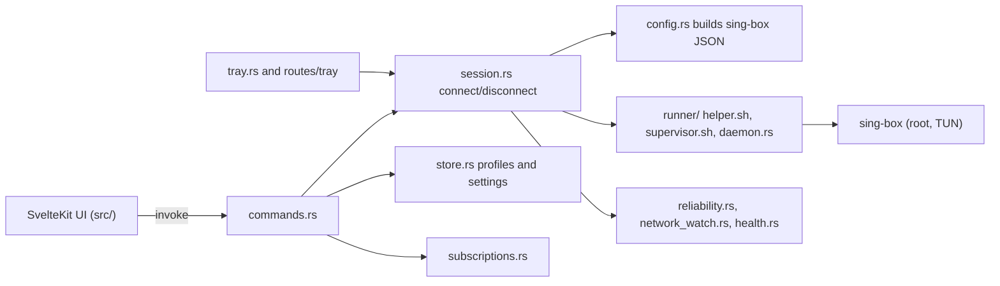

# Architecture (condensed)

Kage VPN is a macOS menu-bar VPN manager. A Tauri 2 shell (Rust) drives a downloaded sing-box engine; a SvelteKit UI shows state.

Text alternative: UI calls Tauri commands; session builds a config via config.rs and starts sing-box through the root runner; store holds data; reliability modules watch network and health; tray is a second UI.

Key facts: profile protocols are modules under src-tauri/src/profile (vless, vmess, trojan, shadowsocks, hysteria2; see docs/ADDING-A-PROTOCOL.md). Settings live in settings.rs (RoutingSettings, ReliabilitySettings, UsageSettings). Kill switch uses pfctl via the root helper. Root helper trusts user-writable files (audit O1).
